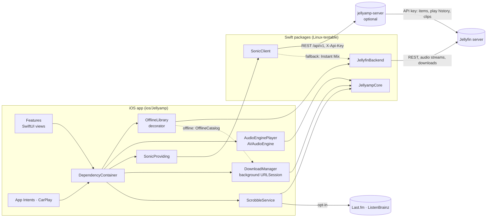

# Architecture

Jellyamp is a monorepo with two deployable artifacts:

1. **iOS app** (`ios/`) — SwiftUI, talks to a Jellyfin server (10.9 or newer).
2. **jellyamp-server** (`server/`) — optional, self-hosted companion that
   analyzes the library's audio and serves the "sonic" features Jellyfin does
   not have.

## Module map

### Swift packages (`ios/Packages/`)

All three depend on Foundation only, build on Linux and carry the unit tests.
`JellyfinBackend` and `SonicClient` depend on `JellyampCore`, not on each
other; there are no third-party Swift dependencies.

| Package | Responsibility | Main types |
|---|---|---|
| `JellyampCore` | Models and every decision that needs no Apple framework | `Track`/`Album`/`Artist`/`Playlist`, `PlayQueue`, `PlayerEngine` (protocol), `CrossfadeCurve`, `SweetFadePlanner`, `LoudnessLeveler`, `SilenceGate`, `SleepTimer`, `PlaybackProfile`, `PlaybackReporter`, `SpectrumBands`, `LyricsTimeline`, `PagedListState`, `SearchRanker`, `DownloadIndex`, `OfflineCatalog`, `OfflineStateTracker`, `SmartSyncPlanner`, `StationSession`, `StationCatalog`, `ScrobbleCoordinator`, `ScrobbleEngine`, `LastFMClient`, `ListenBrainzClient`, `CarPlayListBuilder`, `VoiceMatcher`, `AppSettings`, `BoundedJSONCache`, `HTTPTransport` |
| `JellyfinBackend` | Jellyfin REST (hand-written; no SDK), mapped to Core models | `JellyfinSession`, `JellyfinAuthenticator` (password, Quick Connect, token validation), `JellyfinServerDiscovery`, `MusicLibraryProviding` + `MusicLibraryAPI`, `LibraryBrowseAPI` (paged/sorted/filtered), `LibraryLookupAPI`, `InstantMixAPI`, `LyricsAPI`, `PlaybackReportingAPI`, `StreamURLBuilder`, `ImageURLBuilder`, `OfflineLibrary`, `UnauthorizedReportingTransport` |
| `SonicClient` | The seam to the companion server | `SonicProviding`, `SonicCapabilities`, `SonicAPIClient`, `SonicServerDiscovery`, `JellyfinFallbackSonicProvider` |

### App shell (`ios/Jellyamp/`)

Compiles on macOS only (CI). It holds SwiftUI views and the adapters to Apple
frameworks; the rule is that it stays thin.

| Directory | Content |
|---|---|
| `App/` | `JellyampApp`, `AppDelegate` (audio session, background-download wake-ups), `RootView`, `DependencyContainer` |
| `Features/Onboarding` | Two-step sign-in: server address, then password or Quick Connect (`OnboardingModel`) |
| `Features/Library` | `Shell/AdaptiveShellView` (tab bar on compact width, sidebar on regular width), `Support/AppNavigator` (value-based routes, one path per section), `Support/PagedLoader` (drives one infinitely scrolling list), `Browsers/` (album/artist/track lists with sort, filter, alphabet jump), detail screens, `TrackActions` (context menus), `Components/ToastBanner` (`ToastCenter`) |
| `Features/Search` | Server-side search, grouped and ranked by `SearchRanker`; recent searches |
| `Features/Home` | Shelves: Mixes for You, Sonic Adventure, recently added/played, stations, "Time Travel" decades (`HomeViewModel`) |
| `Features/Sonic` | `StationCoordinator`, Sonic Adventure builder, similar tracks/albums/artists sections, mix detail, sonic server settings |
| `Features/NowPlaying` | `PlayerStateModel` (the one observable the player UI reads), Now Playing, mini player, queue, lyrics, visualizer |
| `Features/Downloads` | Downloads tab, download buttons and badges, offline banner, download settings |
| `Features/Settings` | Playback, equalizer, scrobbling, account, about/licenses |
| `Services/Audio` | `AudioEnginePlayer`, `StreamingAudioSource`, `TrackSchedulerNode`, `SpectrumTap`, `PlaybackSupport` — see [AUDIO-ENGINE.md](AUDIO-ENGINE.md) |
| `Services/Downloads` | `DownloadManager`, `BackgroundDownloadSession`, `DownloadStore`, `OfflineCoordinator`, `OfflineStatus` |
| `Services/Scrobbling` | `ScrobbleService`, `FileScrobbleQueueStore`, `LastFMWebAuthenticator` — see [SCROBBLING.md](SCROBBLING.md) |
| `Services/Intents` | App Intents (`PlaybackIntents`, `JellyampShortcuts`), `MusicCommands` (shared with CarPlay), Spotlight/Handoff activities |
| `Services/CarPlay` | `CarPlaySceneDelegate`, `CarPlayCoordinator` — compiled always, enabled by a build switch; see [CARPLAY.md](CARPLAY.md) |
| `Services/Persistence` | `KeychainCredentialStore`, `UserDefaultsSettingsStore`, `LibraryCache` |
| `Services/SystemMediaController.swift` | Lock screen, remote commands, interruptions, route changes |
| `DesignSystem/` | `GlassStyle` — the only place iOS 26 APIs are called; see [DESIGN.md](DESIGN.md) |

There is no demo mode: App Review signs in to Jellyfin's public demo server
(see [RELEASE.md](RELEASE.md)).

### Companion server (`server/jellyamp_server/`)

FastAPI app (`main.py`), Jellyfin client (`jellyfin.py`), incremental scanner
(`scanner.py`), SQLite store (`store.py`), pluggable analysis (`analysis/`:
`dsp` default, `essentia` optional), sonic features (`sonic/`: similarity
index, adventure, mixes, sage). See [server/README.md](../server/README.md)
and [ADR-0004](adr/0004-fastapi-essentia-backend.md).

## Dependency injection

`DependencyContainer` is one `@MainActor` object for the whole process
(`DependencyContainer.shared`). The SwiftUI window, every App Intent and the
CarPlay scene call `ensureBootstrapped()`, which runs `bootstrap()` exactly
once: load `AppSettings` from UserDefaults, load the stored session from the
Keychain, `activate` it, and validate the token in the background (only an
explicit 401 signs the user out, so offline launches keep working).

`activate(session:)` builds everything that needs a session, in this order:

1. `LibraryCache` scoped to the Jellyfin user ID.
2. `DownloadManager`.
3. `library`: `MusicLibraryAPI` on an `UnauthorizedReportingTransport` (a 401
   triggers re-validation), wrapped by `OfflineCoordinator.activate` in the
   `OfflineLibrary` decorator.
4. `player`: `AudioEnginePlayer`, publishing into the long-lived
   `PlayerStateModel`. The stored EQ preset is applied; the loudness
   fallbacks are injected as closures (`loudnessLookup` → `LoudnessService` →
   sonic server; `albumGainLookup` → library), so the engine never sees the
   container.
5. `SystemMediaController` (lock screen, remote commands).
6. Autoplay: a subscription on the current track that asks the running
   station, or else `RadioQueueFeeder`, to top up the queue.
7. `ScrobbleService.start`.
8. `rewireSonicProvider()`: `SonicAPIClient` when a server URL and key are
   configured, `SonicServerDiscovery` reports it available **and** it
   advertises at least one capability; otherwise
   `JellyfinFallbackSonicProvider` (capabilities `similar`, `stations`). It
   runs again whenever the sonic settings change.

`signOut()` tears all of this down and deletes the session, caches, downloads
and scrobbling accounts.

Features never ask "is the companion server installed?". They read
`container.sonicCapabilities` and leave out what is not supported (Sonic
Adventure, Mixes for You, measured loudness). `PlayerEngine`,
`MusicLibraryProviding` and `SonicProviding` are the protocol seams; views get
the container and `PlayerStateModel` through the SwiftUI environment.

## Data flows

### Play an album

1. `AlbumBrowser` shows albums through a `PagedLoader`, which pages
   `LibraryBrowseAPI` (100 items per page) and paints the cached first page
   from `LibraryCache` before the server answers.
2. `AlbumDetailView` loads `library.tracks(inAlbum:)` — the request goes
   through `OfflineLibrary` to `MusicLibraryAPI` (`albumIds=…&recursive=true`).
3. Tapping a track calls `player.load(queue: PlayQueue(tracks:startAt:))`.
4. `AudioEnginePlayer` picks a stream per track: the downloaded file if there
   is one, else direct play (`/Items/{id}/File`) when `PlaybackProfile` allows
   it for the codec, bitrate and network type, else a progressive MP3
   transcode. `StreamingAudioSource` decodes to PCM and schedules buffers on
   the active `TrackSchedulerNode`; loudness gain and EQ are applied per
   chain.
5. The engine publishes state into `PlayerStateModel`; the mini player, Now
   Playing, `SystemMediaController` and `ScrobbleService` observe it.
6. `PlaybackReporter` produces start/progress/stop reports;
   `PlaybackReportSender` posts them in order to `/Sessions/Playing*`.
7. At a track boundary `SweetFadePlanner` decides: consecutive album tracks
   are joined without a fade, everything else crossfades for the configured
   duration. When the queue runs low, autoplay appends similar tracks.

### Download an album and browse offline

1. The download button calls `DownloadManager.download(album:tracks:)`, which
   adds a **pin** and one entry per track to the `DownloadIndex`.
2. `DownloadIndex` (Core) decides what starts, retries and backs off;
   `BackgroundDownloadSession` transfers the original files from
   `/Items/{id}/Download` in a background `URLSession`, so transfers continue
   while the app is suspended. Files and the index live under
   `Application Support/Downloads/`.
3. `OfflineStateTracker` decides per request whether the library is offline:
   offline mode switched on, no network path, or a request that just failed
   for connectivity reasons (then the server is left alone until a periodic
   probe succeeds).
4. While offline, `OfflineLibrary` answers `MusicLibraryProviding` from
   `OfflineCatalog`, which rebuilds albums, artists, genres, playlists and
   search from the index. Mutations (favorites, playlist edits) throw
   `OfflineLibraryError`; there is no operation queue. `OfflineBanner` shows
   the state.
5. Playback is unchanged: the engine finds the local file through
   `DownloadStore.localURL(for:)`.
6. `OfflineCoordinator` runs smart sync (`SmartSyncPlanner`: favorite songs,
   favorite albums, the newest mixes, a storage limit) and re-syncs pinned
   playlists. It always reads the undecorated server library, so an offline
   answer can never be mistaken for "the playlist shrank".

### Start a station

1. Home builds its station shelves with `StationCatalog` from the library's
   genres, years and recent listening: Library Radio, artist radios, genre
   stations, one station per decade.
2. `StationCoordinator.start` asks `StationSourceFactory` for a `RadioSource`:
   sonically ranked tracks from jellyamp-server when it is connected and
   advertises `stations`/`similar`; otherwise Jellyfin's random-by-genre or
   random-by-decade queries and Instant Mix. Every station therefore works
   against a plain Jellyfin server.
3. `StationSession` (Core) removes duplicates and spaces artists;
   `StationRefill.nextTracks` returns the first batch and the coordinator
   loads it as a new queue.
4. On every track change the container forwards to the coordinator, which
   refills the queue from the same source. A running station takes precedence
   over plain autoplay, and ends when nothing from it is queued any more.

## Persistence

There is no database in the app ([ADR-0005](adr/0005-json-files-instead-of-a-database.md)).
The Jellyfin server is the source of truth; the device holds:

| What | Where | Notes |
|---|---|---|
| Settings (`AppSettings`) | UserDefaults `jellyamp.settings` (JSON) | tolerant decoding: a new field never resets saved settings |
| Device ID, recent searches, last server address | UserDefaults | not secret |
| Jellyfin session + account display info, sonic API key, ListenBrainz token, Last.fm session key | Keychain, service `dev.djtobi.jellyamp` | never in UserDefaults |
| First pages of library lists and Home shelves | `Application Support/LibraryCache/<user>/` (`BoundedJSONCache`) | a cache: 30-day expiry, 2 MB per entry, 20 MB total |
| Download index, genre names, audio files, resume data, artwork | `Application Support/Downloads/` | excluded from backup; index is schema-versioned |
| Scrobble queue | `Application Support/Scrobbling/queue.json` | at most 2000 entries, 14 days |
| Measured loudness | `Caches/loudness/measured.json` | |
| Full-file fallback for unparseable streams | `Caches/audio/` | |

Search is server-side; offline it runs over the download index. The companion
server keeps its derived data in one SQLite file that a scan can rebuild; a
database from another schema version is reset automatically.

## The hybrid seam (Sonic API 1.1)

[SONIC-API.md](SONIC-API.md) is the contract between `SonicClient` and
`server/`. Both sides are tested against the same JSON fixtures
(`server/tests/fixtures/`, mirrored into
`ios/Packages/SonicClient/Tests/SonicClientTests/Fixtures/` by
`scripts/sync-fixtures.sh`; CI fails when the copies differ).

- The app requires major version 1; minor versions are additive, so the
  client ignores unknown fields and capability strings.
- 1.1 added `info.analysis`, `info.scan`, `POST /scan` and `POST /sage`, and
  made `capabilities` reflect what the server can answer right now. A freshly
  installed server reports no capabilities, and the app stays on the Jellyfin
  fallback until the first track is analyzed.
- `SonicAPIClient` implements all of 1.1. The app uses similar, adventure,
  mixes, stations, loudness and the scan status; it has no screen for Sonic
  Sage yet.

## Testing strategy

| Layer | What it proves | Where it runs |
|---|---|---|
| Package unit tests (`swift test` in each package) | All Core logic, request building and response mapping against canned responses, the Sonic client against the shared fixtures | Linux: `core-linux.yml`, locally in the `swift:6.0` container |
| Live Jellyfin suite (`JellyfinLiveTests`, plus the opt-in sign-in and playback-report integration tests) | The whole Jellyfin API layer against a real Jellyfin 10.10.7 with a synthetic library (`scripts/dev-jellyfin/up.sh`); skipped without `JELLYFIN_TEST_*` | Linux: `jellyfin-live` job in `core-linux.yml` |
| Engine simulation (`scripts/engine-sim/run.sh`) | The control flow of the real `AudioEnginePlayer` compiled against fake audio nodes: skips, seeks, crossfade, failures, sleep timer, reports. Not sound | Linux, on demand (not in CI) |
| Server tests (`pytest`, `ruff`) | API contract, scanner, store, sonic math, DSP analysis (needs ffmpeg); an opt-in end-to-end test against a real Jellyfin | Linux: `server.yml`, which also builds and starts the Docker image |
| App target | It compiles, links, archives for Release, and the archive contains what the App Store needs. `JellyampTests` is a placeholder, so there are no app-level unit or UI tests | macOS: `ios.yml` (`macos-26` runner) |
| Release configuration (`scripts/check-appstore-metadata.py`) | Listing text limits, icon, privacy manifest, release-critical plist keys | Linux: `ios.yml` |

Anything audible — decoding, the fades themselves, AirPlay, interruptions,
background downloads, CarPlay — needs a device and is not automated.
