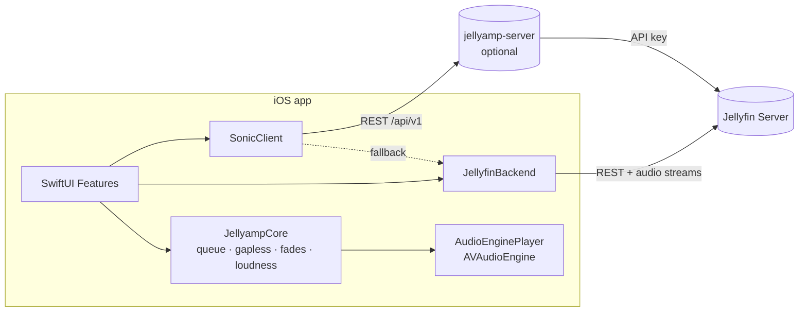

# Architecture

Jellyamp is a monorepo with two deployable artifacts:

1. **iOS app** (`ios/`) — SwiftUI, talks to a Jellyfin server.
2. **jellyamp-server** (`server/`) — optional, self-hosted Docker companion that
   adds audio-embedding-based "sonic" features Jellyfin doesn't have.

## Module map (iOS)

| Module | Platform | Tested on Linux | Responsibility |
|---|---|---|---|
| `JellyampCore` | any (Foundation only) | ✅ | Models, play queue, crossfade/loudness/silence math, gapless planning, direct-vs-transcode decision, playback-report state machine, lyrics timeline, settings models, store protocols |
| `JellyfinBackend` | any | ✅ | Jellyfin REST API mapped to Core models; sign-in and session validation; stream/image URL builders; playback reporting; offline routing (`OfflineLibrary`, `OfflineAwareBrowser`, `OfflineGatedTransport`) |
| `SonicClient` | any | ✅ | `SonicProviding` protocol, REST client for jellyamp-server, Jellyfin-only fallback provider, server discovery |
| App shell `ios/Jellyamp` | iOS | ❌ (CI on macOS) | SwiftUI views, AVAudioEngine player, downloads, Keychain/UserDefaults persistence, MediaPlayer/CarPlay/Siri integration |

**Rule:** the app shell stays thin. Anything that can be expressed without
Apple frameworks lives in a package and gets unit tests that run on Linux.

## Dependency injection

`DependencyContainer` (app shell) wires protocols to live implementations at
launch:

- `MusicLibraryProviding` → `MusicLibraryAPI` (online) wrapped in an offline
  decorator that serves downloaded items when the server is unreachable.
- `PlayerEngine` → `AudioEnginePlayer` (AVAudioEngine).
- `SonicProviding` → `SonicAPIClient` if `SonicServerDiscovery` finds a healthy
  jellyamp-server, else `JellyfinFallbackSonicProvider`.

Features never check "is the backend installed?" — they read
`SonicCapabilities` (from `GET /api/v1/info` or the fallback's static set) and
hide affordances whose capability is absent (e.g. Sonic Adventure without a
backend).

## Data flow: playing an album

1. UI asks `MusicLibraryProviding` for album tracks → Core `Track` models
   (including codec/bitrate/`NormalizationGain` from Jellyfin).
2. `PlayQueue` is loaded; `PlaybackProfile` decides direct-play vs transcode per
   track from codec + network + settings; `StreamURLBuilder` produces the
   URL (original file, or a progressive MP3 transcode).
3. `AudioEnginePlayer` decodes the stream progressively
   (`StreamingAudioSource`; a downloaded file wins), schedules it on one of
   two player nodes and applies loudness gain and crossfade ramps — see
   `docs/AUDIO-ENGINE.md`.
4. `PlaybackReporter` (Core state machine) emits start/progress/stop events;
   `PlaybackReportingAPI` posts them to `/Sessions/Playing*` so Jellyfin tracks
   play counts and resume state.

## Persistence

No database (ADR-0003's GRDB plan was dropped before 1.0). Settings are one
JSON blob in UserDefaults (`SettingsStoring`), credentials and tokens live in
the Keychain, downloads keep a JSON `DownloadIndex` next to the files, and
`LibraryCache` holds first pages of lists per user for an instant launch.

## Session lifecycle

`DependencyContainer.shared` is the one container of the process (window,
Siri/Shortcuts intents and CarPlay all use it) and is bootstrapped exactly once
(`ensureBootstrapped`). A session ends in one of two ways:

- **Sign Out** (user): the token is revoked and everything belonging to the
  account is removed — downloads, library cache, sonic server key, scrobbling
  accounts.
- **Expired** (the server answers 401 and `JellyfinAuthenticator.validate`
  confirms it): only the session ends. Downloads and settings stay; the stored
  session keeps server and user ID without the token, onboarding shows a
  notice, and the next sign-in wipes the local data only if it is a different
  user.

Both go through `tearDownSession`, which stops the engine explicitly
(`PlayerEngine.shutdown`), so no audio or lock-screen entry outlives the
session. Every Jellyfin client is built with the container's session
transport (`UnauthorizedReportingTransport`), so any authenticated request
that comes back 401 triggers the validation.

Favorites have one write path, `FavoritesModel.set` (optimistic, rolled back
on failure): in-app hearts, the lock screen's like command, CarPlay and the
Siri intent all call it; the container mirrors each change into the player's
queued tracks. Settings are persisted and applied by the container whenever
`settings` changes.

## Downloads & offline

Offline content is described by one JSON document, the `DownloadIndex`
(JellyampCore, schema-versioned, `Application Support/Downloads/index.json`,
excluded from backup): the downloaded tracks with their queue state, and the
**pins** that keep them — album, playlist, artist, single track, or the smart
sync pin. A track stays on disk for as long as one pin references it.

- **Decisions are pure Core code**: queue transitions and retry backoff
  (`DownloadQueue.swift`), relaunch reconciliation, file naming, storage math,
  `SmartSyncPlanner`, and `OfflineCatalog`, which rebuilds albums / artists /
  genres / playlists / search from the index.
- **The app shell adapts**: `BackgroundDownloadSession` wraps a background
  `URLSession` (originals from `/Items/{id}/Download`), `DownloadManager`
  persists the index and executes its decisions, `OfflineCoordinator` runs
  smart sync and playlist re-sync.
- **`OfflineLibrary`** (JellyfinBackend) is the decorator around
  `MusicLibraryProviding`. `OfflineStateTracker` decides per request: offline
  mode on or no network path → serve the catalog; a request failing for
  connectivity reasons → serve the catalog and stop asking the server until a
  periodic probe succeeds. Mutations throw `OfflineLibraryError` while offline
  (no operation queue).
- The same tracker routes the other Jellyfin clients: `OfflineAwareBrowser`
  (paged browsing: server, else a browser over the offline-decorated library)
  and `OfflineGatedTransport` (ID lookups, stations, Instant Mix, playback
  reports: nothing to fall back to, so they fail at once while offline).

## The hybrid seam (companion backend optional)

`docs/SONIC-API.md` is the contract. Both sides are tested against the same
JSON fixtures (`server/tests/fixtures/` ↔ `SonicClientTests`), so the iOS
client can be developed before the backend ships and the contract cannot drift
silently.
